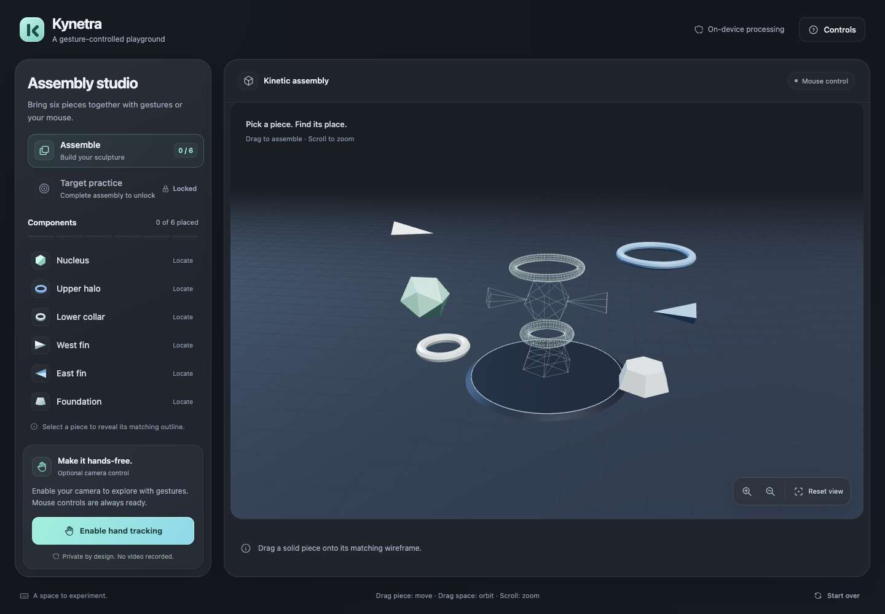

# Kynetra — A Gesture-Controlled 3D Playground

Kynetra explores hands-free spatial interaction in the browser. Use a webcam to orbit a 3D scene, point at objects, and move them with a closed fist. A mouse works too, so the experience is usable before granting camera access.

The idea is to investigate a small question: how much of a spatial interface can feel understandable when your hands replace the usual controls? Assembling a six-piece kinetic sculpture gives that question a concrete task. Target practice then reuses the same pointing and fist gestures in a different context.

This is an experimental portfolio project, not a general-purpose hand-tracking library or a precise 3D editor.



## The experience

The playground opens in **Assemble** mode. Six solid components surround a wireframe sculpture: a nucleus, upper halo, lower collar, two fins, and a foundation. Each component has one matching socket. Place all six to unlock **Target practice**.

In target practice, aim at the coral wireframe targets and fire. Clearing five targets starts another wave after a short pause. You can return to the assembled sculpture through the mode selector. Switching modes clears the current targets; the score remains until **Start over**, which resets both modes.

The interface includes component highlighting, snap feedback, a controls dialog, view reset and zoom buttons, camera startup/cancellation states, and specific errors for common camera failures. The layout adapts to smaller screens, including single-pointer touch controls.

## Run locally

Requirements:

- Node.js **24 or later**, **22.13 or later within 22.x**, or **20.19 or later within 20.x**, matching `package.json`.
- npm and internet access to install dependencies.
- A current browser with WebGL2 and hardware acceleration. Chrome or Edge on desktop is a practical starting point. Other browsers and mobile devices need device-specific testing.
- For gestures: a working webcam, camera permission, and internet access for the MediaPipe model and WebAssembly runtime.

Download or clone this repository, open a terminal in its root directory, then run:

```bash
npm ci
npm run dev
```

Open the address printed by Vite, normally **http://127.0.0.1:5173/**. If that port is occupied, Vite selects another and prints it. Do not open `index.html` directly with `file://`; the application uses JavaScript modules and a build tool.

There are no API keys, environment variables, accounts, or backend services to configure.

To check and preview the production build:

```bash
npm run lint
npm test
npm run build
npm run preview
```

The preview address is normally **http://127.0.0.1:4173/**. Stop either server with `Ctrl+C`. `npm run build` writes a static site to `dist/`; it can be served by a static host. Relative asset paths support hosting beneath a subdirectory. Hosted camera access requires HTTPS.

## Deploy on Vercel

Import the GitHub repository into Vercel and use these settings:

| Setting | Value |
| --- | --- |
| Framework preset | **Vite** |
| Root directory | Repository root (`.`) |
| Install command | `npm ci` |
| Build command | `npm run build` |
| Output directory | `dist` |
| Node.js version | A Vercel-supported version satisfying `package.json` (Node 24+ is allowed) |
| Required environment variables | None |

The application is a static Vite build with no server routes or backend. Vite copies the worker, favicon, and local icon assets from `public/` into `dist/`; deploy the complete output directory. No custom `vercel.json` or SPA rewrite is needed for this single-page interface, which has no client-side URL routing.

Vercel's HTTPS URL satisfies the browser's secure-context requirement for webcam access. Users still need to grant camera permission, and hand tracking still downloads its pinned runtime/model assets from external servers. Leave `VITE_PERF_MONITOR` unset for the normal production build.

See [Vercel's Vite deployment documentation](https://vercel.com/docs/frameworks/frontend/vite).

## Controls

### Hand gestures

Click **Enable hand tracking** and allow camera access. Startup loads the tracking code, runtime, and model; the rest of the playground remains available. **Cancel camera startup** stops the attempt, and **Disable hand tracking** releases the camera after startup.

Use one hand for pointing, grabbing, and orbiting. Keep the hand in frame, with even light and a clear view of your fingers.

| Gesture | Assembly | Target practice |
| --- | --- | --- |
| Open palm | Move the palm to orbit the camera | Orbit the camera |
| Extended index finger, other fingers folded | Move the cursor; aim over a component | Aim at a target |
| Closed fist | Grab the pointed component and move it | Fire repeatedly while held, with a 300 ms cooldown |
| Two visible hands | Spread apart to zoom in; bring together to zoom out | Same zoom control |

For assembly, point at a solid component, briefly hold the pointing pose, then close your fist. The cursor anchors to its last pointed position while your palm drives the grab. Move laterally to reposition the piece. Moving your hand toward the webcam increases its apparent size and brings the held piece closer to the camera; moving away pushes it deeper into the scene. Open your hand near its matching outline to release and snap.

A gesture must remain stable briefly before it takes effect. A short tracking dropout hides the cursor; sustained loss cancels the grab and returns the piece to where that grab began. Two-hand zoom takes priority over one-hand actions and releases a held piece.

### Mouse, touch, and keyboard

| Input | Action |
| --- | --- |
| Drag a solid component | Move it across a plane facing the camera |
| Scroll while holding a component | Adjust its depth; scroll down to push away, up to bring closer |
| Release near its matching wireframe | Snap into place |
| Drag empty space in assembly, or right-drag | Orbit the camera |
| Scroll without a held component | Zoom |
| Click or tap a target in target practice | Fire |
| `+`, `−`, and Reset view buttons | Adjust or restore the camera |
| Component button | Highlight that piece and its socket |
| Start over | Reset the sculpture, score, and wave |

The foundation starts farther in front of its socket than the other pieces. If its outline lines up on screen but snapping is not ready, scroll down slightly while holding it. Snapping checks real 3D distance, not just screen overlap.

Touch supports dragging and view buttons, but has no separate drag-depth gesture. A mouse or webcam provides the full depth control needed from arbitrary views.

With the canvas focused, arrow keys orbit, `+` / `−` zoom, and `Home` resets the view. `Escape` cancels a grab. Tab navigation reaches interface controls and the controls dialog, but placing pieces and shooting targets require a pointer or camera; there is no complete keyboard-only 3D interaction path.

Mouse activity temporarily takes priority over hand input. Switching away from the browser tab cancels active grabs, pauses animation, and stops the camera. Enable hand tracking again when you return.

## Technologies and implementation

- **Vanilla JavaScript modules** keep the application small enough to follow without a UI framework. HTML and CSS own the interface; JavaScript updates it when state or feedback changes.
- **Three.js** handles the WebGL scene, procedural geometry, materials, camera, projection, and raycasting. No external 3D models or texture downloads are needed.
- **MediaPipe Tasks Vision** supplies 21 hand landmarks per hand. Gesture recognition is application code, separate from model inference. Tracking code is loaded only when camera tracking starts; the worker imports the same pinned package from the CDN, and the compatibility fallback lazy-loads the npm bundle.
- **Vite** provides local module serving and production bundling. Three.js is split into its own build chunk, while MediaPipe remains a separate lazy import.
- **ESLint** catches JavaScript issues. **Node's built-in test runner** tests critical logic without a separate test framework.

### Input and gesture stability

Finger extension uses joint angles and wrist-distance ratios rather than comparing finger-tip Y coordinates. This makes classification less dependent on wrist rotation. Only explicit palm, index-point, and fist poses become those commands; ambiguous poses are left unclassified.

A temporal filter requires 70 ms of consistent classification, smooths cursor coordinates and hand scale, resets camera deltas on gesture changes, and clears tracking after 220 ms without a valid hand. Fist movement anchors to the palm so folding the index finger does not throw the cursor off the selected object. Two-hand zoom uses palm separation and is unaffected by the order of the two detections.

The tracking service owns webcam access and model lifetime. Compatible browsers first try the GPU delegate in a classic Web Worker using OffscreenCanvas and transferred ImageBitmaps. If GPU initialization or warmup fails, startup tries a CPU worker before the main-thread compatibility path. There is one capture/inference in flight, with no frame queue. Video-frame callbacks and a guarded timer schedule inference independently of the animation loop; unchanged frames are skipped. Its maximum rate is 20 Hz, with the actual interval adapted to inference cost. Browsers without a working worker path use a more conservatively throttled main-thread fallback. This fallback can still cause short rendering pauses because the library call itself is synchronous.

### Picking and assembly

Picking first raycasts the actual component meshes. If it misses, a small screen-space tolerance around component centers makes thin geometry easier to select. Installed pieces are removed from the selectable collection.

Dragging preserves the initial pick offset and intersects the cursor ray with a camera-facing plane. Depth input moves that plane. Position and depth are bounded to prevent pieces from disappearing arbitrarily far away. A piece can snap only to its own socket within 0.72 scene units, and each component can be installed once. Installed pieces ease into their exact socket positions. Completing the six-piece set unlocks the second mode; there is no separate counter that can drift out of sync with installed IDs.

### Animation and lifecycle

One animation loop drives camera damping, interactions, sculpture updates, targets, beam effects, and rendering. Camera inference has its own scheduler. Static assemblies skip most scene redraws, with a sparse 250 ms heartbeat to avoid compositor idle stalls; the loop still services input and UI. Once sculpture or targets animate, rendering continues. Motion uses elapsed time rather than a fixed increment per frame. Target movement stays within a small region around its spawn position, and beam effects expire inside the same loop.

Renderer pixel ratio starts at a maximum of 1.5. Sustained slow frames can lower it to 0.75; quality recovers slowly when frame times improve. At minimum resolution, continued load enables a 30 FPS update/render cap with periodic recovery probes. These heuristics do not guarantee a frame-rate target, and known main-thread inference stalls do not trigger resolution reductions. Meshes and socket outlines share geometry. A resize observer keeps the renderer aligned with its container. Hidden tabs stop animation and camera capture; teardown removes listeners, closes the hand model, stops video tracks, and disposes scene geometry, materials, and renderer resources. Beam geometry and materials are reused between shots, then disposed at teardown. Picking reuses hit/projection buffers and runs only when the cursor, camera, or selectable set changes. Cursor DOM updates are coalesced at up to 30 Hz and use transforms rather than layout properties. Reduced-motion preferences stop decorative sculpture and target movement while keeping deliberate camera and object controls available.

## Project structure

```text
.
├── index.html                 # Semantic interface, metadata, controls dialog
├── package.json               # Dependencies, runtime requirement, commands
├── package-lock.json          # Reproducible dependency installation
├── vite.config.js             # Relative build paths and Three.js chunk
├── eslint.config.js
├── scripts/
│   └── benchmark.cjs           # Optional matched browser profiling harness
├── public/
│   ├── icons.svg              # Local Tabler outline icon sprite
│   ├── icons-license.txt      # Tabler MIT license
│   ├── favicon.svg
│   └── hand-worker.js          # Classic worker, WASM model, bitmap inference
├── src/
│   ├── main.js                # Composition, mode changes, lifecycle
│   ├── performance.js         # Optional development diagnostics
│   ├── animation.js           # Single frame loop and visibility handling
│   ├── ui.js                  # DOM rendering and feedback
│   ├── styles.css             # Visual identity and responsive layout
│   ├── core/
│   │   ├── assembly.js        # Component definitions and snap rules
│   │   ├── math.js            # Clamping and time-based damping
│   │   ├── quality.js          # Adaptive resolution and frame cap
│   │   └── state.js           # Installed IDs, mode, selection, score
│   ├── input/
│   │   ├── gestures.js        # Landmark classification and temporal filter
│   │   ├── inference.js        # Worker setup and compatibility fallback
│   │   ├── hand-tracker.js    # Webcam, lazy model loading, inference
│   │   ├── hand-controls.js   # Gestures mapped to scene commands
│   │   ├── interaction.js     # Picking, dragging, depth, release, firing
│   │   └── pointer-controls.js
│   └── scene/
│       ├── world.js           # Renderer, lighting, environment, camera
│       ├── sculpture.js       # Component meshes and socket presentation
│       └── simulation.js      # Target waves, hit detection, beam effects
├── docs/
│   ├── kynetra-interface.png  # Actual application preview
│   ├── performance.md         # Audit, measurements, methodology, limits
│   └── performance-results.json
└── tests/
    ├── animation.test.js
    ├── assembly.test.js
    ├── gestures.test.js
    ├── interaction.test.js
    ├── quality.test.js
    ├── simulation.test.js
    └── tracker.test.js
```

`dist/` and `node_modules/` are generated and ignored. To change the sculpture, start with `COMPONENTS` in `src/core/assembly.js` and the shape factory in `src/scene/sculpture.js`. Gesture thresholds live in `src/input/gestures.js`; camera limits live in `src/scene/world.js`.

## Camera and network behavior

Camera frames are processed locally in the browser. This application does not record, store, or upload video. Camera permission is requested only after pressing the tracking button, and no microphone access is requested.

Worker tracking downloads the pinned MediaPipe JavaScript bundle and WebAssembly runtime from **jsDelivr** and the versioned hand-landmarker model from **Google Cloud Storage**. Those asset requests still contact third-party servers; local inference does not mean the application is fully offline. Camera-blocking browser policies, network restrictions, missing hardware, or download failures leave mouse controls available with a retry action.

The MediaPipe package version in `package.json` and `VISION_VERSION` in `src/input/inference.js` must stay aligned when upgrading. For a deployment that needs offline gesture support, host the runtime and model assets locally and change those URLs.

## Verification and limitations

`npm test` also checks single-flight scheduling, rejection of late results, idle raycast caching, shared geometry, beam reuse, adaptive-quality hysteresis, frame caps, and visibility cleanup. It covers rotated and scaled hand poses, invalid landmarks, gesture dwell, cursor anchoring, palm transition stability, loss recovery, two-hand ordering, snap bounds, duplicate installation, mode locking/reset, current-ray picking, cancellation, and camera permission cancellation races. These are synthetic fixtures and targeted integration tests, not measurements of recognition accuracy on real hands.

Browser checks during this refactor exercised desktop and mobile layouts, all six mouse placements, mode unlocking, target hits, restart, the controls dialog, and camera-denied fallback in headless Chrome. A synthetic webcam stream also verified the actual MediaPipe model/runtime downloads, blank-frame inference, and camera shutdown. Physical webcam gesture quality and browser/device compatibility still need hands-on evaluation.

Known limits:

- Hand pose estimates vary with lighting, occlusion, distance, and camera angle. Stable depth control is harder than moving a mouse; hand size is an approximate depth signal, not a distance measurement.
- Worker inference still consumes CPU and adds capture/transfer latency. Unsupported workers fall back to synchronous main-thread inference, which can stutter even when throttled. No physical-device frame-rate guarantee is made.
- Touch provides a useful subset of controls, and the scene does not yet offer full keyboard or screen-reader manipulation.
- Screen overlap does not guarantee a snap: components must be close in three dimensions. The selection tolerance is a small convenience, not an occlusion-aware picking system.
- WebGL context loss shows a reload message; automatic scene restoration is not implemented.
- There is no persistence, physics engine, collision system, leaderboard, or saved assembly state. Reloading starts a new session.

Useful next steps would be broader device/delegate benchmarks, a visual hand calibration guide, self-hosted tracking assets, richer nonvisual/keyboard controls, and testing with recorded landmark sequences from varied users and devices. Each would address a specific limitation rather than add another mode.

## Performance diagnostics

Run `npm run dev` to collect development diagnostics. The monitor is hidden by default; open `?perf=1` to reveal its diagnostics dock. It reports loop FPS and frame p95, actual redraw frequency, render submission CPU time, update CPU time, inference duration/rate, capture-to-result age, draw calls, triangle count, worker/fallback backend, and pixel ratio. Its DOM text refreshes once per second while visible. **Hide monitor** hides the panel; `?perf=0` disables monitoring entirely on reload.

Production builds exclude the monitor module by default. To explicitly include diagnostics in a temporary production build on macOS/Linux:

```bash
VITE_PERF_MONITOR=true npm run build
npm run preview
```

Build again with ordinary `npm run build` before publishing without diagnostics. In development, `?tracking=main` forces the compatibility path for testing, and `?quality=high` disables automatic quality changes at the normal 1.5 DPR ceiling. Do not use the fallback switch to judge worker performance.

Read [the performance audit](docs/performance.md) for matched measurements and limitations. Rendering time measures JavaScript submission, not GPU completion; loop FPS differs from redraw rate when a static scene needs no new image. In a monitored development session, `window.__kynetraPerf.reset()` starts a fresh measurement window and `window.__kynetraPerf.report()` returns its data.

## Interface system

The interface uses a graphite palette, mint/cyan controls, cool blue sculpture accents, and native system typography. Shared color, radius, and shadow tokens live at the top of `src/styles.css`. The sidebar groups mode selection, component progress, and optional camera control; short desktop windows use a compact component grid, and mobile places the canvas before the supporting panels.

Floating view controls and completion feedback use small frosted surfaces. Motion is limited to state transitions, press feedback, and loading indicators, with reduced-motion and reduced-transparency support. The scene's lighting and surface colors match the surrounding shell; its geometry and interaction behavior are unchanged by the interface redesign.

Icons come from [Tabler Icons](https://github.com/tabler/tabler-icons), bundled locally as an SVG sprite. Their MIT license is included in `public/icons-license.txt`. No UI framework, icon runtime, or font download is required.
